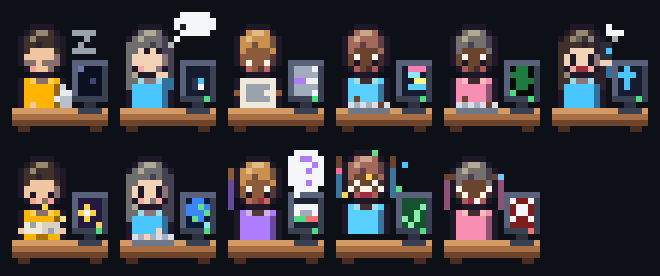
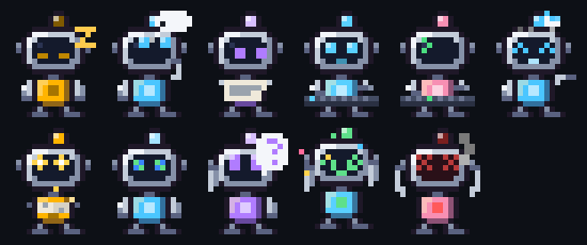
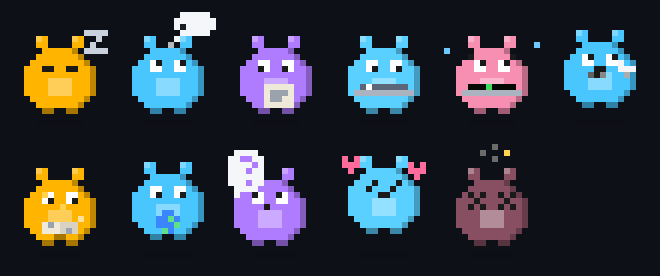

# Agent Office

**A live pixel-art office right above your Claude Code prompt.** Your orchestrator and every subagent it delegates to sit in a band as little characters, animated by what each one is doing right now: reading, writing, running commands, consulting a skill, browsing, delegating, or waiting for you.

Built for repositories made of **git submodules** (or any monorepo) where one orchestrator hands work to one subagent per component: each subagent is named after the folder it works on.

[Português](README.pt-BR.md)

| Office | Robot | Tamagotchi |
| :---: | :---: | :---: |
|  |  |  |

## Install

At the prompt of a Claude Code terminal session:

```
/plugin install submodules-agent-office --marketplace orseni/submodules-agent-office
```

Answer `y` to add the marketplace, then pick a scope:

- **project**: only the project you are in shows the office. Install it again in each project you want.
- **user**: every project shows it.

The band shows up above the prompt as soon as the session starts. `/agent-office` hides it and brings it back; the engine's `[-]` (or ctrl+x ctrl+a) collapses it for a moment.

Requires a Claude Code build with function-hook mods (2.1.294 or newer) and a terminal with truecolor (iTerm2, Ghostty, WezTerm, Kitty, the VS Code terminal…).

## What each character shows

Rows in the GIFs above, left to right: idle, thinking, reading, writing, running, delegating, skill, web, waiting, done, error.

| State | When | Animation |
| --- | --- | --- |
| idle | nothing to do; the orchestrator's turn is over | naps, coffee, `z z z` |
| thinking | between tool calls | thought bubble with dots |
| reading | `Read`, `Grep`, `Glob` | holds a sheet, eyes scanning |
| writing | `Edit`, `Write`, `NotebookEdit` | types; code scrolls on the monitor |
| running | `Bash`, `PowerShell`, `Monitor` | types fast on a green terminal |
| delegating | `Agent`, `SendMessage`, `Workflow` | on the phone; a paper plane flies out |
| skill | `Skill` | an open book with sparkles |
| web | `WebFetch`, `WebSearch`, browser MCP tools | a spinning globe |
| waiting | `AskUserQuestion`, `ExitPlanMode`, a permission dialog | raises a hand; `?` bubble |
| done | a subagent finished; the orchestrator's turn ended | arms up, confetti |
| error | a command failed; a subagent stopped on an error | hands on head, red screen |

Each card also shows the agent's name, what it is doing (`Edit lambda_function.py`, `$ make test`), how long it has been in the room, its tool calls and, for subagents, the tokens their run used. A subagent stays in the room after it finishes and leaves when you send the next prompt.

"Waiting" means a person is needed: it follows the permission dialog Claude Code really shows, so auto mode's own decisions never light it up.

## Settings

The band is 6 lines tall: slim 20×10 characters with their name, state, current action and stats beside them, lined up from right to left (the orchestrator holds the right end). More agents than fit wrap into another row. When the terminal is too short even for that, it turns into a list with one line per agent. Prefer big characters? Set `large` to `true` for 16×20 sprites in a 15-line band.

Switch the avatar from the prompt. The choice is kept across sessions.

```
/agent-office                      hide or show the band
/agent-office robot                office | robot | tamagotchi
/agent-office hide                 hide | show
```

Defaults live in the plugin's config (`/config`, or `pluginConfigs` in settings):

| Option | Default | |
| --- | --- | --- |
| `avatar` | `office` | `office`, `robot`, `tamagotchi` |
| `large` | `false` | big 16×20 characters (15-line band) instead of slim ones (6 lines) |
| `language` | `en` | `en`, `pt-BR` |
| `showOnStart` | `true` | show the band when a session starts |
| `statusLine` | `true` | "Agent Office · 2 working · 1 need you" in the status line |
| `notify` | `false` | a toast when a subagent finishes or fails |

## How subagents get their names

At session start the office lists the project's top-level folders and the paths in `.gitmodules`. When the orchestrator delegates, the subagent is named after the first of those folders its prompt mentions. A delegation prompt like

```
You are acting as the specialist agent for neuronio-dashboard-api.
Scope: files inside neuronio-dashboard-api/ only.
```

gives a character called `neuronio-dashboard-api`, with its own color. Without a match the name comes from the Agent call's `name`, its working directory, its custom agent type (`code-reviewer`), or its description.

## How it works

It is a [Claude Code mod](https://code.claude.com/docs): a plugin of function hooks, no server and no dependencies.

- `agent.spawn` brings a subagent into the room; `tool.call` (which carries the subagent's id) sets what each agent is doing; `classic.PermissionRequest` marks who needs you; `turn.complete` ends a run.
- A large character is a 16×20 sprite packed into 16×10 terminal cells with half blocks (`▀`); a slim one is 20×10 packed into 10×5 cells with quadrant blocks (`▚`), two colors per cell. Both are drawn in a `Raster` in the band above the prompt (`AbovePrompt`) and repainted about 8 times a second with `$.ui.blit`, without redrawing the band.
- The hooks never block a tool call or a turn: a fault inside the office is swallowed so the session goes on.

```
hooks/
  register.tsx          events, band, command
  lib/model.ts          who is in the room and what they do (pure)
  lib/tools.ts          tool → state
  lib/naming.ts         subagent names and colors
  lib/canvas.ts         pixel canvas and Raster encoding
  lib/fx.ts             bubbles, props and particles
  lib/avatars/          office, robot, tamagotchi
  lib/i18n.ts           en, pt-BR
tests/office.test.ts    Claude Code plugin tests
scripts/                checks and preview rendering (Node, dev only)
```

## Develop

```bash
git clone https://github.com/orseni/submodules-agent-office
cd submodules-agent-office
claude --plugin-dir .            # run it; edits hot-reload
npm run check                    # model, naming and sprite checks (Node)
npm run validate                 # claude plugin validate .
npm test                         # claude plugin test .
npm run previews                 # regenerate docs/*.gif
```

A new avatar is one file in `hooks/lib/avatars/` drawing the 11 states, plus its name in `AVATARS` and in the i18n tables.

## License

[MIT](LICENSE)
